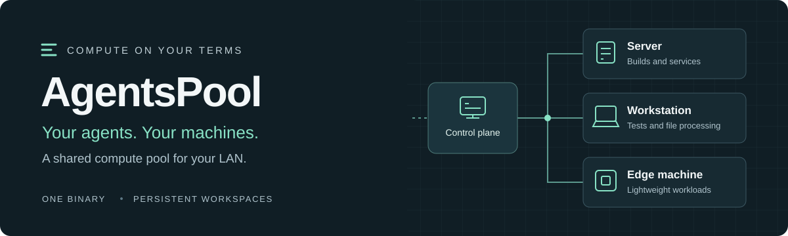
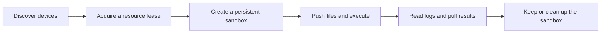

<p align="center">
  
</p>

<h1 align="center">AgentsPool</h1>

<p align="center"><strong>Give your Agents access to the compute already on your LAN.</strong></p>

<p align="center">
  <a href="LICENSE"></a>
  <a href="CHANGELOG.md"></a>
  <a href="docs/PLATFORMS.md"></a>
  <a href="https://linux.do/"></a>
</p>

<p align="center">
  <a href="README.md">简体中文</a> · <strong>English</strong><br>
  <a href="#quick-start">Quick start</a> · <a href="docs/README.md">Docs</a> · <a href=".agents/skills/agentspool-compute/SKILL.md">Agent Skill</a> · <a href="CONTRIBUTING.md">Contribute</a>
</p>

---

Your Agent runs on one computer. Your LAN may have a server, a spare laptop, or an ARM board with capacity to spare. AgentsPool lets the Agent discover those machines, reserve CPU, memory and disk, run commands in a scoped sandbox, and bring the results back.

The calling Agent keeps its own model, context and tool loop. Remote machines run an AgentsPool Worker and do not need the same Agent runtime. Agents that can read a Skill and invoke a CLI share the same interface.

Version **0.4.0-alpha.4** targets trusted LANs and private networks. Licensed under [MIT](LICENSE).

## What you can do

| Capability | Behavior |
|---|---|
| **Choose where work runs** | Inspect online status, available resources and sourced device descriptions; the Agent selects a node and requests capacity against the current registry revision |
| **Reserve resources for each workload** | CPU, memory and disk leases back persistent sandboxes with cgroup limits and dedicated ext4 volumes |
| **Keep remote working directories** | `/workspace` and `/home/agent` survive between commands; stopping releases CPU and memory while retaining files and disk capacity |
| **Read output while it runs** | Durable logs use byte cursors; results keep a 64 KiB tail, full logs are retained by default, and rotation is explicit |
| **Move files deliberately** | Push inputs, pull results, identify content by SHA256, and clean up sandbox files and Artifacts |
| **Discover long-running services** | Declare endpoints on an execution so other Agents can discover them and check health; completion withdraws the endpoints |

Use it for remote builds and tests, batch file processing, or persistent LAN services. Sourced device descriptions record intended use and constraints. Human instructions take precedence over Agent recommendations.

## Quick start

### Try it on one Linux machine

Start in a source checkout. This installs a control plane and Worker on the same machine, then runs a sandbox. The example targets Ubuntu / Debian with systemd, cgroup v2 and sudo access. Install Go and Make first. Binary archives need no Go compiler; see the [platform matrix](docs/PLATFORMS.md) for other targets.

```sh
sudo apt-get update
sudo apt-get install -y bubblewrap e2fsprogs util-linux python3 curl age jq
make build

# Install the control plane; it binds to 127.0.0.1:8090 by default.
sudo ./scripts/install-server.sh ./dist/agentspool

# Register a local Worker and install the persistent sandbox helper.
sudo env AGENTSPOOL_SERVER=http://127.0.0.1:8090 \
  AGENTSPOOL_JOIN_TOKEN_FILE=/etc/agentspool/join.token \
  ./scripts/install-worker.sh ./dist/agentspool
```

The installer creates distinct Admin, Allocator and Join credentials. Give the client user a protected copy of the Allocator file to discover machines and request resources.

```sh
install -d -m 0700 "$HOME/.config/agentspool"
sudo install -o "$(id -u)" -g "$(id -g)" -m 0600 \
  /etc/agentspool/allocator.token "$HOME/.config/agentspool/allocator.token"

./scripts/install-client.sh ./dist/agentspool http://127.0.0.1:8090 \
  "$HOME/.config/agentspool/allocator.token"
export PATH="$HOME/.local/bin:$PATH"

agentspool tool devices.list
```

Choose an online Worker's `node_id` from the response and replace the value below. The output file must not already exist.

```sh
./scripts/first-sandbox.sh node_REPLACE_WITH_WORKER_ID /tmp/agentspool-result.txt
cat /tmp/agentspool-result.txt
# HELLO FROM AGENTSPOOL
```

The script reserves resources, creates a sandbox, pushes a file, executes a command, reads logs and downloads the result. It then destroys the test sandbox and releases its lease, waiting for each operation to complete.

### Add a second machine

Bind the control plane to its actual private address, transfer a protected Join Token file to the second machine to register its Worker, and point the client at the same control plane. Workers connect outbound; routine operations use the API.

Follow the [two-machine quickstart](docs/QUICKSTART.en.md) for configuration, credential transfer and verification. Docker Compose can run the control plane. Persistent sandbox Workers and helpers use native Linux installations.

## How Agents use it

Client installation also installs the [`agentspool-compute` Skill](.agents/skills/agentspool-compute/SKILL.md). The CLI exposes 30 discoverable tools with authorization requirements, input JSON Schema and examples.

```sh
# Local discovery, without a control-plane connection.
agentspool tool list --json
agentspool tool describe leases.acquire --json
agentspool tool describe sandboxes.exec --json

# Live device discovery.
agentspool tool devices.list
```



Allocator credentials authorize discovery and admission. Subsequent calls use scoped Lease / Sandbox Tokens. The client profile stores the server URL and credential file locators. Provider credentials, prompts and Agent sessions stay with the caller.

Leases and commands have no deadline by default. Set `ttl_seconds` or `timeout_seconds` explicitly when needed. Stopping preserves data, starting requires capacity admission again, and an idle sandbox can resize CPU and memory or grow its disk.

See the [Agent tool reference](docs/AGENT-TOOLS.zh-CN.md) for the full contract.

## Deployment

One `agentspool` binary provides these entry points.

| Entry point | Runs on | Responsibility |
|---|---|---|
| `server` | Control-plane machine | Device registry, admission, leases, operation state and file transfer |
| `worker` | Compute machine | Node telemetry, task claims and sandbox operation forwarding |
| `sandboxd` | Worker machine | Root helper for isolation using systemd, bwrap and ext4 |
| `tool` | Agent machine | Shared JSON CLI for discovery and operations |

The control plane and Worker can share a host. A Task API remains available for deterministic batch jobs. Version 0.4 removes the former Agent-hosting components; existing 0.2 / 0.3 installations should read the [migration guide](docs/MIGRATION-v0.4.zh-CN.md) before upgrading.

## Operating boundaries

AgentsPool is a single-control-plane Alpha for trusted machines. Persistent sandboxes use Linux namespaces and cgroups. They do not provide hardware VM isolation or hostile multi-tenant isolation. There is no highly available control plane or cross-node shared POSIX volume.

Persistent sandboxes isolate networking by default. Explicit `permissions.network=true` grants the node network. Native shell/process Tasks use the host network and require trusted workloads; `ALLOW_NETWORK=false` controls Docker Tasks. Optional GPU telemetry does not enable GPU allocation, sandbox mounting or model deployment.

The control plane listens on loopback by default. Use TLS and access controls across untrusted networks. See the [security boundaries](docs/SECURITY.md).

## Documentation and verification

| Topic | Start here |
|---|---|
| Installation and the first sandbox | [English quickstart](docs/QUICKSTART.en.md) · [中文快速上手](docs/QUICKSTART.zh-CN.md) |
| Architectures and prerequisites | [Platform support](docs/PLATFORMS.md) |
| Tools, objects and APIs | [Agent tools](docs/AGENT-TOOLS.zh-CN.md) · [OpenAPI](api/openapi.yaml) |
| Architecture and data retention | [Architecture](docs/ARCHITECTURE.zh-CN.md) · [Data lifecycle](docs/DATA-LIFECYCLE.zh-CN.md) |
| Upgrades and recovery | [Migration](docs/MIGRATION-v0.4.zh-CN.md) · [Backup and recovery](docs/BACKUP_RECOVERY.zh-CN.md) |
| Implementation and changes | [Implementation status](docs/IMPLEMENTATION_STATUS.zh-CN.md) · [Changelog](CHANGELOG.md) |

Development and release checks run locally.

```sh
make check           # Docs, API, SDK, static checks and tests
make race            # Go race checks
make e2e             # Real server / worker Task workflow
make release         # Four target archives, checksums and SPDX SBOM
make release-verify  # Reproducible builds and source archive verification
```

Persistent sandbox integration tests use real systemd, bwrap and ext4. On a disposable Linux test machine, run `sudo python3 scripts/e2e-sandboxes.py dist/agentspool`. Cross-compilation and execution on target hardware are qualified separately.

## Contributing

Bug reports, platform qualification and documentation improvements are welcome. Read [Contributing](CONTRIBUTING.md) before submitting changes, and describe the resulting behavior and how you verified it. Follow the [security reporting policy](SECURITY.md) for vulnerabilities.

## Acknowledgements

Thanks to the **[LINUX DO](https://linux.do/)** community for its support. Community members are welcome to try AgentsPool, share use cases and suggest improvements.

<a href="https://linux.do/"></a>

## License

[MIT](LICENSE) · 七叶怀瑾 and AgentsPool contributors
