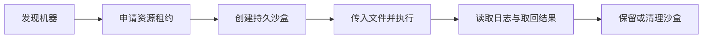

<p align="center">
  
</p>

<h1 align="center">AgentsPool</h1>

<p align="center"><strong>让 Agent 用上你的局域网计算资源。</strong></p>

<p align="center">
  <a href="LICENSE"></a>
  <a href="CHANGELOG.md"></a>
  <a href="docs/PLATFORMS.md"></a>
  <a href="https://linux.do/"></a>
</p>

<p align="center">
  <strong>简体中文</strong> · <a href="README.en.md">English</a><br>
  <a href="#快速上手">快速上手</a> · <a href="docs/README.md">文档</a> · <a href=".agents/skills/agentspool-compute/SKILL.md">Agent Skill</a> · <a href="CONTRIBUTING.md">参与贡献</a>
</p>

---

你的 Agent 在一台电脑上工作，局域网里可能还有服务器、旧笔记本和 ARM 小主机。AgentsPool 把这些机器的可用资源交给 Agent 发现和选择，让它申请 CPU、内存和磁盘，在独立沙盒中运行命令，再把结果带回来。

Agent 继续使用自己的模型、上下文和工具循环。远程机器只需运行 AgentsPool Worker，无需安装同一套 Agent 运行时。支持读取 Skill 和调用 CLI 的 Agent，都可以使用同一套接口。

当前版本 **0.4.0-alpha.4**，面向可信局域网与私有组网，采用 [MIT 协议](LICENSE)。

## 能做什么

| 能力 | 实际行为 |
|---|---|
| **把工作放到合适的机器上** | 读取在线状态、可用资源和机器说明，由 Agent 选择节点，再按当前 revision 申请资源 |
| **为每份工作留出资源** | 申请 CPU、内存和磁盘租约，持久沙盒使用 cgroup 与独立 ext4 卷约束资源 |
| **保留远程工作目录** | `/workspace` 与 `/home/agent` 跨命令保留，停止沙盒释放 CPU 和内存，磁盘与文件继续保留 |
| **执行时就能看日志** | 用字节游标读取持久日志，执行结果保留 64 KiB 尾部预览，完整日志默认保留，可显式设置轮转 |
| **明确地移动文件** | 推送输入文件、取回结果，通过 SHA256 标识内容；支持沙盒文件与 Artifact 清理 |
| **发现长期运行的服务** | 执行时声明服务地址，其他 Agent 可查询入口与健康状态；执行结束后撤下入口 |

可以把它用于远程构建和测试、批量文件处理，或在局域网机器上运行持续服务。机器的用途和限制可以写成带来源的说明，人的规定优先于 Agent 的建议。

## 快速上手

### 先在一台 Linux 机器上跑通

下面从源码目录开始，在同一台机器上安装控制面和 Worker，再创建第一个沙盒。示例适用于有 systemd、cgroup v2 和 sudo 权限的 Ubuntu / Debian；需要先安装 Go 和 Make。二进制发行包无需 Go，其他平台请看[支持矩阵](docs/PLATFORMS.md)。

```sh
sudo apt-get update
sudo apt-get install -y bubblewrap e2fsprogs util-linux python3 curl age jq
make build

# 安装控制面，默认监听 127.0.0.1:8090
sudo ./scripts/install-server.sh ./dist/agentspool

# 注册本机 Worker，并安装持久沙盒 helper
sudo env AGENTSPOOL_SERVER=http://127.0.0.1:8090 \
  AGENTSPOOL_JOIN_TOKEN_FILE=/etc/agentspool/join.token \
  ./scripts/install-worker.sh ./dist/agentspool
```

安装器生成独立的 Admin、Allocator 和 Join 凭据。将 Allocator 文件交给当前客户端用户，Agent 就能查看机器和申请资源。

```sh
install -d -m 0700 "$HOME/.config/agentspool"
sudo install -o "$(id -u)" -g "$(id -g)" -m 0600 \
  /etc/agentspool/allocator.token "$HOME/.config/agentspool/allocator.token"

./scripts/install-client.sh ./dist/agentspool http://127.0.0.1:8090 \
  "$HOME/.config/agentspool/allocator.token"
export PATH="$HOME/.local/bin:$PATH"

agentspool tool devices.list
```

从返回结果中选择在线 Worker 的 `node_id`，替换下方示例值。输出文件需要尚不存在。

```sh
./scripts/first-sandbox.sh node_REPLACE_WITH_WORKER_ID /tmp/agentspool-result.txt
cat /tmp/agentspool-result.txt
# HELLO FROM AGENTSPOOL
```

这个脚本会申请资源、创建沙盒、推送文件并执行命令，读取日志后取回结果，最后销毁测试沙盒并释放租约。每一步都等待实际操作完成。

### 接入第二台机器

让控制面监听实际的私有地址，把受保护的 Join Token 文件交给第二台机器注册 Worker，再把客户端指向同一个控制面。Worker 主动连接控制面，日常调用通过 API 完成。

具体配置、凭据传递和验收步骤见[双机快速上手](docs/QUICKSTART.zh-CN.md)。Docker Compose 可用于运行控制面，持久沙盒的 Worker/helper 使用原生 Linux 安装。

## Agent 如何使用

安装客户端时会一起安装 [`agentspool-compute` Skill](.agents/skills/agentspool-compute/SKILL.md)。CLI 提供 30 个可发现工具，每个工具都带有权限说明、输入 JSON Schema 和调用示例。

```sh
# 本地发现，无需连接控制面
agentspool tool list --json
agentspool tool describe leases.acquire --json
agentspool tool describe sandboxes.exec --json

# 从实际部署读取机器状态
agentspool tool devices.list
```

一次远程工作的顺序如下。



Agent 用 Allocator 凭据发现机器和申请租约，后续操作使用范围限定的 Lease / Sandbox Token。客户端配置只保存服务地址与凭据文件路径。模型供应商凭据、Prompt 和 Agent Session 留在调用方。

租约和命令默认没有时间截止。需要限时时，显式设置 `ttl_seconds` 或 `timeout_seconds`。停止沙盒保留数据，重新启动需要再次满足资源准入；空闲时可调整 CPU、内存或增长磁盘。

完整调用方式见[通用 Agent 工具](docs/AGENT-TOOLS.zh-CN.md)。

## 部署结构

一个 `agentspool` 二进制提供以下入口。

| 入口 | 运行位置 | 职责 |
|---|---|---|
| `server` | 控制面机器 | 设备登记、资源准入、租约、操作状态与文件中转 |
| `worker` | 提供计算资源的机器 | 上报节点状态、领取任务并代理沙盒操作 |
| `sandboxd` | Worker 所在机器 | 以 root helper 配合 systemd、bwrap 和 ext4 执行隔离操作 |
| `tool` | Agent 所在机器 | 通过统一 JSON CLI 发现和调用工具 |

控制面和 Worker 可以共用一台机器。项目保留用于确定性批处理的 Task API；0.4 已移除旧版 Agent 托管组件。现有 0.2 / 0.3 安装请先阅读[迁移说明](docs/MIGRATION-v0.4.zh-CN.md)。

## 使用边界

AgentsPool 当前是单控制面的 Alpha，适合可信设备组成的局域网。持久沙盒使用 Linux namespace 与 cgroup，没有硬件虚拟机或敌对多租户的隔离承诺；也不提供高可用控制面和跨节点共享 POSIX 卷。

持久沙盒默认隔离网络，显式授予 `permissions.network=true` 后使用节点网络。原生 shell/process Task 使用宿主网络，只适合可信任务；`ALLOW_NETWORK=false` 控制 Docker Task 的网络行为。GPU 仅可用于可选遥测，不参与资源分配、沙盒挂载或模型部署。

控制面默认只监听 loopback。跨不可信网络使用 TLS 与访问控制，详细配置见[安全边界](docs/SECURITY.md)。

## 文档与验证

| 想了解什么 | 从这里开始 |
|---|---|
| 安装、接入机器和跑通第一个沙盒 | [中文快速上手](docs/QUICKSTART.zh-CN.md) · [English quickstart](docs/QUICKSTART.en.md) |
| 硬件架构与系统要求 | [平台支持](docs/PLATFORMS.md) |
| 工具、对象与 API | [Agent 工具](docs/AGENT-TOOLS.zh-CN.md) · [OpenAPI](api/openapi.yaml) |
| 架构与数据保留策略 | [架构](docs/ARCHITECTURE.zh-CN.md) · [数据生命周期](docs/DATA-LIFECYCLE.zh-CN.md) |
| 升级、备份与恢复 | [迁移指南](docs/MIGRATION-v0.4.zh-CN.md) · [备份恢复](docs/BACKUP_RECOVERY.zh-CN.md) |
| 当前实现与变更记录 | [实现状态](docs/IMPLEMENTATION_STATUS.zh-CN.md) · [Changelog](CHANGELOG.md) |

开发与发布检查可以在本地运行。

```sh
make check           # 文档、API、SDK、静态检查与测试
make race            # Go 并发检查
make e2e             # 真实 server / worker Task 流程
make release         # 四架构归档、校验和与 SPDX SBOM
make release-verify  # 复现构建与源码归档验证
```

持久沙盒集成测试使用真实 systemd、bwrap 和 ext4，在可丢弃的 Linux 测试机上运行 `sudo python3 scripts/e2e-sandboxes.py dist/agentspool`。交叉编译通过与目标机器运行验收分别记录。

## 参与贡献

欢迎反馈使用问题、补充平台验收和改进文档。提交变更前请阅读 [Contributing](CONTRIBUTING.md)，说明改动后的行为与验证结果。安全问题请按[漏洞报告流程](SECURITY.md)处理。

## 致谢

感谢 **[LINUX DO](https://linux.do/)** 社区的支持，也欢迎社区的朋友来体验 AgentsPool、交流使用场景和提出建议。

<a href="https://linux.do/"></a>

## License

[MIT](LICENSE) · 七叶怀瑾与 AgentsPool 贡献者
